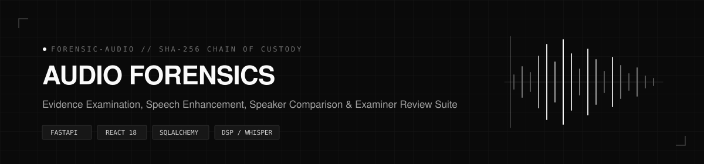
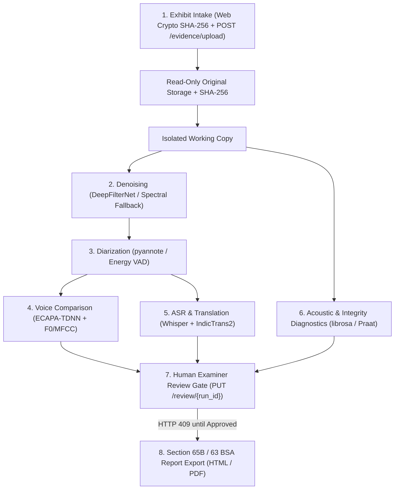

<div align="center">
  

  <br /><br />

  <p>
    
    
    
    
    
  </p>
</div>

---

## Overview

The **Forensic Audio Evidence Analysis Platform** (`forensic-audio-`) is an end-to-end laboratory examination workstation for questioned audio recordings. It combines cryptographic evidence intake, non-destructive working-copy isolation, multi-stage signal enhancement and acoustic-phonetic analysis, speaker comparison, multilingual transcription/translation, and examiner-gated **Section 65B (Indian Evidence Act)** / **Section 63 (Bharatiya Sakshya Adhiniyam, 2023)** report generation.

> [!IMPORTANT]
> **Evidentiary Scope & Examiner-Review Safeguard:**
> All automated outputs—including denoising diagnostics, speaker diarization, ECAPA-TDNN / acoustic-phonetic similarity scores, integrity flags, and ASR transcripts—are **decision-support tools only**. Automated metrics **never** independently establish speaker identity or guarantee legal admissibility. Report export is locked at the API layer (`HTTP 409 Conflict`) until a qualified human examiner reviews the findings, documents limitations (e.g., overlapping speech, clipping, telephonic bandwidth, or low SNR), and explicitly approves the conservative conclusion.

---

## Core Capabilities

- **Cryptographic Chain of Custody & Immutability**
  - Original evidence files are stored strictly read-only (`backend/storage/originals/`) and are never processed in place.
  - SHA-256 hashes are computed immediately on upload (client-side via Web Crypto API and server-side via `hashutil.py`), and every derived intermediate (working copy, denoised audio, spectrogram PNG, exported report) is hashed and linked to its parent.
  - Append-only `AuditLogs` record every operation with actor, action, input/output hashes, model/tool versions, parameters, and timestamps.
- **Pluggable Signal Processing & ML Pipeline (with Deterministic Fallbacks)**
  - **Denoising (`denoise.py`):** DeepFilterNet neural enhancement with adaptive spectral-gating fallback, hum/hiss detection, and over-processing warnings.
  - **Diarization (`diarize.py`):** `pyannote.audio` speaker turn segmentation with energy-VAD clustering fallback.
  - **Voice Comparison (`compare.py`):** SpeechBrain ECAPA-TDNN deep speaker embedding cosine similarity combined with acoustic-phonetic F0 pitch contours and MFCC spectral distance.
  - **Transcription & Translation (`transcribe_translate.py`):** OpenAI Whisper ASR aligned to speaker turns, plus IndicTrans2 translation support for English, Hindi, and Marathi (with structured locale-stub fallback in lightweight CPU deployments).
  - **Acoustic & Integrity Diagnostics (`acoustic_integrity.py`):** Pitch contours, formants, spectral centroid, zero-crossing rate, clipping detection, splice-jump heuristics, and ENF/deepfake warning indicators.
- **Examiner Review Station & Dual Report Export**
  - Synchronized dual waveform and high-resolution spectrogram inspection (original vs. processed).
  - Server-side official HTML/PDF report generation (`Jinja2` + `fpdf2`) and client-side interactive PDF export (`jsPDF`), structured for Part-A (technical hash verification) and Part-B (examiner certification).

---

## System Architecture



### Repository Layout

```text
forensic-audio-/
├── backend/
│   ├── app/
│   │   ├── main.py             # FastAPI entrypoint
│   │   ├── models.py           # SQLAlchemy 2.0 schema (Evidence, Runs, AuditLogs, Reports)
│   │   ├── audit.py            # Immutable forensic audit logger
│   │   ├── hashutil.py         # SHA-256 hashing utilities
│   │   ├── storage.py          # Original / working / output isolation
│   │   └── routers/            # evidence.py, pipeline_status.py, review.py, export.py
│   ├── pipeline/               # denoise, diarize, compare, transcribe_translate, acoustic_integrity, report, orchestrator
│   ├── storage/                # originals/, working/, outputs/
│   └── tests/                  # Pytest API & audio utility integration tests
├── src/
│   ├── screens/                # Dashboard, Preprocessing, Comparison, Transcription, Report
│   ├── components/             # AudioPlayer, AudioWaveform, SpectrogramView, SpeakerTimeline, FlowStepper
│   ├── services/api.js         # API client & browser SHA-256 hashing
│   └── utils/pdfExport.js      # Client-side jsPDF report builder
├── docker-compose.yml          # Full-stack composition (FastAPI, Nginx SPA, PostgreSQL 16)
└── scripts/install_ml.sh       # Optional heavy neural model installer
```

---

## API & Reverse Proxy Surface

| Endpoint | Purpose |
| :--- | :--- |
| `POST /evidence/upload` | Ingest questioned audio exhibit, compute SHA-256, create working copy, start pipeline |
| `GET /evidence/{id}` | Retrieve exhibit metadata, hashes, and custody lineage |
| `GET /pipeline/{run_id}/status` | Poll asynchronous stage progress and intermediate metrics |
| `GET / PUT /review/{run_id}` | Fetch findings or submit examiner review approval/rejection |
| `GET /export/{run_id}` | Export Section 65B / 63 BSA HTML or PDF report (**returns `409` until examiner-approved**) |
| `GET /health` | Service health check |

---

## Setup & Installation

### Prerequisites

- **Python** `3.11+` (`python3 -m venv` recommended)
- **Node.js** `18+`
- **FFmpeg** (recommended for `.m4a`, AAC, and non-standard `.mp3` containers; `soundfile` handles `.wav`/`.flac` directly)

### 1. Install Dependencies

```bash
# Install frontend and core backend dependencies
npm run setup

# Optional: install full local ML models (PyTorch, DeepFilterNet, pyannote, SpeechBrain, Whisper)
npm run setup:ml
```

### 2. Run Locally

```bash
# Start FastAPI (port 8000) and Vite SPA (port 5173) concurrently
npm run dev
```

- **Frontend UI:** `http://localhost:5173`
- **Backend OpenAPI Docs:** `http://localhost:8000/docs`

To run services individually:
- `npm run dev:backend` — FastAPI on port `8000`
- `npm run dev:ui` — Vite dev server on port `5173`

### 3. Run via Docker Compose

```bash
docker compose up --build
```

Starts PostgreSQL 16 (`5432`), FastAPI (`8000`), and the Nginx SPA (`5173`).

---

## Verification & Testing

```bash
# Backend integration & audio utility tests
python3 -m pytest backend/tests -v

# Production frontend build validation
npm run build
```

---

## Legal & Compliance Notes

1. **Statutory Certification:** Under **Section 65B of the Indian Evidence Act** and **Section 63 of the Bharatiya Sakshya Adhiniyam (BSA) 2023**, electronic records require certification by a person occupying a responsible official position in relation to the operation of the relevant device.
2. **Deterministic Fallback Transparency:** Whenever optional heavy ML weights (`deepfilternet`, `pyannote.audio`, `speechbrain`, `openai-whisper`, `IndicTrans2`) are not installed, the pipeline executes deterministic acoustic fallbacks (spectral gating, energy VAD, MFCC cosine) and explicitly logs the active engine and version in both the audit trail and final report.
